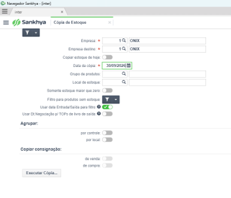
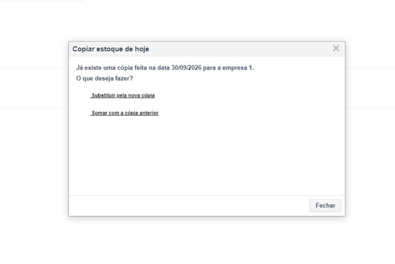

# Passo a Passo: Cópia de Estoque no Sankhya

Este manual orienta sobre o procedimento de realização da cópia de estoque no sistema Sankhya em conjunto com a equipe (Carlos e Richard).

---

## Passo 1: Acessar a rotina de Cópia de Estoque

1. Acesse o sistema **Sankhya**.
2. Vá até a opção **Cópia de Estoque**.

---

## Passo 2: Preenchimento dos Campos

Preencha os campos conforme as orientações abaixo:

* **Empresa:** `1 - ONIX`
* **Empresa destino:** `1 - ONIX`
* **Data da cópia:** Insira a data referente ao mês em que está sendo feito o ajuste junto ao Carlos e Richard (no exemplo da tela, refere-se ao último dia do mês de setembro).

<!-- ADICIONE A FOTO DO PREENCHIMENTO DOS CAMPOS AQUI -->
 Exemplo de sintaxe:  

---

## Passo 3: Executar a Cópia e Substituição

Após realizar os ajustes necessários, clique no botão **Executar Cópia...**.

* Caso o sistema exiba um aviso informando que já existe uma cópia feita na data para a empresa, selecione a opção **"Substituir pela nova cópia"**.

<!-- ADICIONE A FOTO DO AVISO DE SUBSTITUIÇÃO DE CÓPIA AQUI -->
Exemplo de sintaxe:  
